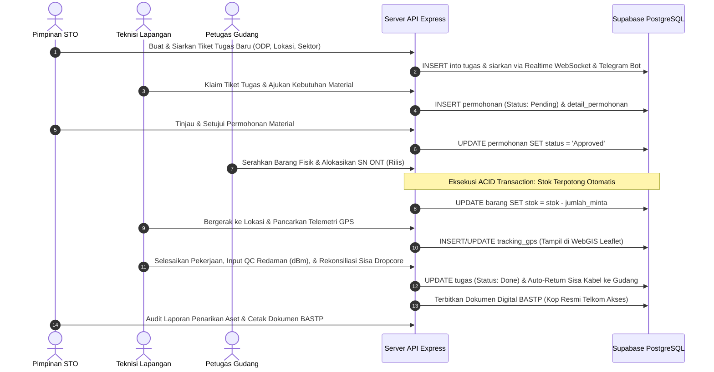

# Sistem Informasi Manajemen Teknisi & Inventaris Gudang Berbasis WebGIS
### STO Telkom Akses Payakumbuh

[](https://react.dev/)
[](https://vitejs.dev/)
[](https://tailwindcss.com/)
[](https://leafletjs.com/)
[](https://nodejs.org/)
[](https://supabase.com/)
[](https://telegram.org/)

> **Laporan Proyek Kerja Praktek (KP)**  
> Program Studi Teknik Informatika — **Sekolah Tinggi Teknologi Payakumbuh (STT Payakumbuh)**  
> Bekerja sama dengan: **Sentral Telepon Otomat (STO) Telkom Akses Payakumbuh**, Koto Nan IV, Kota Payakumbuh, Sumatera Barat.  
> **Repository Resmi:** [https://github.com/aii0808/sto-telkom.git](https://github.com/aii0808/sto-telkom.git)

---

## 👥 Tim Pengembang Kerja Praktek

Proyek ini dikembangkan oleh Tim Mahasiswa Kerja Praktek Teknik Informatika STT Payakumbuh:

| Nama Pengembang | Program Studi / Instansi | Peran & Tanggung Jawab |
| :--- | :--- | :--- |
| **Ari Suandi Putra** | Teknik Informatika, STT Payakumbuh | Full-stack Development & Modul Logistik Gudang |
| **Margi Pangestu** | Teknik Informatika, STT Payakumbuh | Integrasi WebGIS & Telemetri Tracking GPS |
| **Natasya Lutfyah Ramadhan** | Teknik Informatika, STT Payakumbuh | Analisis Sistem, Alur SOP & Dokumentasi Teknis |
| **Raihan Alhamidy** | Teknik Informatika, STT Payakumbuh | Arsitektur Frontend React, UI/UX & Quality Assurance |
| **Restui Zai** | Teknik Informatika, STT Payakumbuh | Integrasi Backend Express & Supabase Realtime DB |

---

# BAGIAN 1 — GAMBARAN SISTEM & ALUR OPERASIONAL (STAKEHOLDER & PENGUJI)

## 1.1 Latar Belakang & Permasalahan

Sentral Telepon Otomat (STO) Telkom Akses Payakumbuh melayani instalasi baru (*Pasang Baru / PSB*) dan perbaikan gangguan jaringan *fiber optic* (IndiHome) di seluruh penjuru Kota Payakumbuh dan sekitarnya. Dalam aktivitas harian, ditemukan beberapa kendala operasional:

1. **Monitoring Armada Lapangan yang Tersebar:** Pimpinan/NOC kesulitan memantau posisi dan beban kerja teknisi secara visual dan *real-time*.
2. **Pencatatan Material Rawan Selisih (Discrepancy):** Pengeluaran material bernilai tinggi seperti Modem Optical Network Terminal (ONT) dan kabel *drop core* sebelumnya mengandalkan nota/pencatatan manual yang rentan terhadap selisih stok fisik versus buku inventaris.
3. **Dokumen BASTP Fisik yang Rentan:** Berita Acara Serah Terima Pekerjaan (BASTP) fisik berbasis kertas berisiko tercecer, basah di lapangan, dan sulit dicari kembali saat audit berkala.
4. **Visibilitas Kapasitas Jaringan (ODP):** Teknisi di lapangan seringkali harus menebak ketersediaan *port* kosong pada tiang ODP (Optical Distribution Point), yang memperpanjang waktu penanganan (*Mean Time to Repair / MTTR*).

## 1.2 Solusi yang Dihadirkan

Aplikasi ini menyatukan pemetaan geografis (*WebGIS*), otomasi logistik pergudangan, pelacakan armada teknisi, serta penerbitan dokumen legal digital ke dalam satu ekosistem terpadu:

* 🗺️ **Peta WebGIS Interaktif & Radar Armada:** Visualisasi seluruh titik ODP di Payakumbuh lengkap dengan status okupansi *port* (Tersedia, Hampir Penuh, Penuh, Maintenance) serta pelacakan titik koordinat GPS teknisi yang bertugas.
* 📦 **Digitalisasi Manajemen Logistik Gudang:** Pengajuan barang oleh teknisi, otorisasi persetujuan bertingkat (*Approval Pimpinan*), dan rilis fisik barang oleh petugas gudang dengan pemotongan stok otomatis (*Atomik ACID Transaction*).
* 📝 **BASTP Digital & Rekonsiliasi Material Konsumsi:** Validasi *Serial Number* (SN) Modem ONT, pencatatan hasil ukur redaman optik (OPM dBm standar Telkom: -16 s/d -24 dBm), pengalihan status material menjadi *Terpasang di Pelanggan (Consumed)*, serta pengembalian otomatis sisa kabel (*retur*) ke stok gudang.
* 🔒 **Kepatuhan Privasi Data Pelanggan (UU PDP):** Penerapan sensor otomatis (*masking*) nama dan nomor kontak pelanggan bagi peran non-pimpinan untuk melindungi kerahasiaan data pribadi pelanggan.
* 🤖 **Integrasi Bot Telegram (`@sto_pyk_bot`):** Siaran instan tiket gangguan baru ke grup teknisi beserta tautan akses cepat *Magic Link*.

---

## 1.3 Hak Akses & Peran Pengguna (Role-Based Access)

Sistem menerapkan pembagian tugas dan wewenang yang tegas (*Separation of Duties*):

```
┌────────────────────────────────────────────────────────────────────────┐
│                   PERAN & WEWENANG SISTEM STO TELKOM                   │
├────────────────────┬────────────────────┬──────────────────────────────┤
│   👔 PIMPINAN STO   │ 👷 TEKNISI LAPANGAN │       📦 BAGIAN GUDANG       │
├────────────────────┼────────────────────┼──────────────────────────────┤
│ • Monitoring WebGIS│ • Ambil/Klaim Tiket│ • Manajemen Master Stok      │
│ • Approval Material│ • Input GPS Lokasi │ • Rilis Barang Fisik         │
│ • Terbitkan Tiket  │ • Ajukan Material  │ • Alokasi SN Modem ONT       │
│ • Audit & Cetak    │ • Closing & Rekon  │ • Masking Data Pelanggan     │
│   Laporan BASTP    │ • Terbitkan BASTP  │   sesuai Regulasi UU PDP     │
└────────────────────┴────────────────────┴──────────────────────────────┘
```

1. **Pimpinan STO (Supervisor / NOC Lead):**
   * Memantau sebaran armada teknisi dan status tiket secara spasial pada peta WebGIS.
   * Memberikan persetujuan (*approval*) atau penolakan (*reject*) atas permohonan material.
   * Menerbitkan tiket baru ke *pool* terbuka atau menugaskan teknisi tertentu.
   * Mengunduh rekapitulasi audit material dan mencetak salinan BASTP resmi.
2. **Teknisi Lapangan (Field Operation Engineer):**
   * Mengambil tiket pekerjaan dari *open pool* atau notifikasi siaran Bot Telegram.
   * Mengajukan kebutuhan material fisik (Modem ONT, kabel *drop core*, roset, dll.).
   * Mengirimkan telemetri posisi koordinat GPS saat mobilisasi ke rumah pelanggan.
   * Melakukan *closing* tiket: menginput SN ONT, hasil ukur redaman OPM (dBm), mengunggah foto bukti, dan meretur sisa material ke gudang.
3. **Bagian Gudang (Logistics & Inventory Officer):**
   * Mengelola katalog barang, batas stok minimum, dan pencatatan serial number.
   * Menyerahkan fisik material kepada teknisi berdasarkan tiket permohonan yang disetujui.
   * Menerima rekonsiliasi pengembalian sisa kabel (*retur*) otomatis dari lapangan.
   * Memeriksa audit aset pelanggan dengan proteksi sensor data pribadi (UU PDP).

---

## 1.4 Alur Kerja Operasional (SOP Sistem End-to-End)

Diagram interaksi berikut mengilustrasikan alur operasional standar dari penerbitan tiket tugas hingga penyelesaian pekerjaan dan penerbitan BASTP digital:



### Rincian Tahapan Standar Operasional Prosedur (SOP):

| No | Tahap Operasional | Penanggung Jawab | Deskripsi Teknis |
|:--:|:---|:---|:---|
| **1** | **Penerbitan Tiket** | Pimpinan STO | Pimpinan membuat tiket kerja (*Pasang Baru / Gangguan*) beserta koordinat acuan ODP dan instruksi penanganan. |
| **2** | **Siaran Multi-Kanal** | Server Backend | Tiket disiarkan secara instan ke portal aplikasi teknisi melalui *WebSocket* dan ke grup Telegram `@sto_pyk_bot`. |
| **3** | **Klaim & Pengajuan** | Teknisi Lapangan | Teknisi mengambil tiket dari *pool*, lalu menyusun daftar permohonan material sesuai panjang tarikan kabel dan kebutuhan perangkat. |
| **4** | **Otorisasi Material** | Pimpinan STO | Pimpinan memverifikasi kewajaran jumlah barang yang diminta sebelum pengeluaran logistik diizinkan. |
| **5** | **Serah Terima Fisik** | Petugas Gudang | Petugas gudang menyerahkan material fisik ke teknisi dan mencatat *Serial Number* (SN) Modem ONT yang dialokasikan. |
| **6** | **Pemotongan Stok Atomik** | Database Server | Sistem memotong kuantitas stok barang di gudang secara atomik (*ACID transaction*) untuk menjamin konsistensi data inventaris. |
| **7** | **Mobilisasi & Tracking** | Teknisi & WebGIS | Perangkat teknisi menyiarkan titik koordinat lapangan sehingga pergerakan armada terpantau pada peta WebGIS. |
| **8** | **Closing & QC Optik** | Teknisi Lapangan | Teknisi menginput parameter QC (redaman optik OPM dalam satuan dBm), foto hasil pekerjaan, dan rincian kabel yang terpasang. |
| **9** | **Rekonsiliasi Retur** | Sistem & Gudang | Perangkat ONT dinyatakan resmi *Terpasang di Pelanggan (Consumed)*, sedangkan sisa potongan kabel *drop core* dikembalikan otomatis ke stok gudang. |
| **10** | **Penerbitan BASTP** | Sistem Terpadu | Dokumen Berita Acara Serah Terima Pekerjaan (BASTP) digital diterbitkan lengkap dengan nomor registrasi unik, foto bukti, dan tanda tangan elektronik. |

---

# BAGIAN 2 — PANDUAN PENGEMBANG & IMPLEMENTASI TEKNIS (MAINTAINER)

## 2.1 Arsitektur & Teknologi (Tech Stack)

Aplikasi dibangun menggunakan arsitektur *Decoupled Client-Server* modern:

```
┌────────────────────────────────────────────────────────────────────────┐
│                   ARSITEKTUR PERANGKAT LUNAK STO                       │
├────────────────────────────────────────────────────────────────────────┤
│  [ FRONTEND (Client SPA) ]                                             │
│  React 19 + Vite 8 + Tailwind CSS v4 + Leaflet.js (WebGIS OSM)         │
│  Port: 5173                                                            │
│       │                                                                │
│       ├── (HTTP REST / JSON via Axios) ──────────────┐                 │
│       └── (Realtime WebSocket Subscriptions) ──┐    │                 │
│                                                │    │                 │
│  [ BACKEND (REST API Server) ]                 │    │                 │
│  Node.js + Express.js 5 + Bcrypt + Telegram SDK│    │                 │
│  Port: 5000                                    │    │                 │
│       │                                        │    │                 │
│       └── (Database Query / PostgREST) ─┐      │    │                 │
│                                         ▼      ▼    ▼                 │
│  [ SUPABASE CLOUD POSTGRESQL ] ─────────────────────────────────────── │
│  Tables: tugas, permohonan, barang, odp, pelanggan, auth_tokens        │
└────────────────────────────────────────────────────────────────────────┘
```

* **Frontend:**
  * **Framework:** React 19 dengan compiler Vite 8 untuk performa *bundling* instan.
  * **Styling:** Tailwind CSS v4 (*Design system* responsif, mendukung Dark Mode & Light Mode).
  * **GIS Engine:** Leaflet.js + OpenStreetMap (Tile Server lokal Payakumbuh Koto Nan IV: `Lat -0.2288, Lng 100.6318`).
  * **Icons:** Lucide React Icons.
  * **HTTP Client:** Axios dengan *Request Interceptor* autentikasi.
* **Backend:**
  * **Runtime:** Node.js (LTS v18+ atau v20+).
  * **Framework:** Express.js 5 (REST API Endpoint architecture).
  * **Keamanan:** Bcrypt Password Hashing, CORS Whitelist, Data Masking UU PDP.
* **Database & Layanan Cloud:**
  * **Database:** Supabase Cloud PostgreSQL dengan fitur *Realtime Replication*.
  * **Messaging:** Telegram Bot API via HTTPS Webhook/Polling (`@sto_pyk_bot`).

---

## 2.2 Struktur Direktori Proyek

Codebase disusun dalam hierarki yang bersih dan modular:

```text
sto-telkom/
├── sto-backend/                     # Direktori Server Backend (Node.js & Express)
│   ├── src/
│   │   ├── config/                  # Konfigurasi Supabase Client & environment
│   │   ├── controllers/             # Logika bisnis per modul:
│   │   │   ├── authController.js    # Login, register, magic link token
│   │   │   ├── barangController.js  # Inventaris & stok barang gudang
│   │   │   ├── odpController.js     # Master data ODP & koordinat geografis
│   │   │   ├── permohonanController.js # Alur pengajuan, approval, dan rilis material
│   │   │   ├── tugasController.js   # Lifecycle tiket kerja & closing BASTP
│   │   │   └── telegramController.js# Pengiriman pesan aman bot Telegram
│   │   ├── routes/                  # Definisi rute REST API Express
│   │   ├── services/                # Layanan integrasi Bot Telegram
│   │   ├── utils/                   # Helper response JSON & sanitasi data
│   │   ├── app.js                   # Konfigurasi Express, middleware, CORS
│   │   └── server.js                # Entry point server HTTP (Port 5000)
│   ├── .env.example                 # Template environment variable backend
│   └── package.json
│
├── sto-frontend/                    # Direktori Aplikasi Klien (React & WebGIS)
│   ├── src/
│   │   ├── api/                     # Axios instance & Supabase client wrapper
│   │   ├── components/              # Komponen antarmuka pengguna (UI):
│   │   │   ├── WebGISMap.jsx        # Peta WebGIS Leaflet interaktif & visualisasi ODP
│   │   │   ├── WebGISTracking.jsx   # Radar pelacak GPS armada teknisi
│   │   │   ├── ModernSidebar.jsx    # Navigasi sidebar responsif
│   │   │   ├── InputBarangGudang.jsx# Form penambahan & restock logistik gudang
│   │   │   ├── ApprovalMaterial.jsx # Panel persetujuan material pimpinan
│   │   │   ├── UploadBuktiModal.jsx # Modal closing pekerjaan, QC OPM, & BASTP
│   │   │   ├── ModalBASTP.jsx       # Template Berita Acara resmi siap cetak
│   │   │   └── TabelPelangganAset.jsx# Master pelanggan terlindungi UU PDP
│   │   ├── context/                 # State management global (AppContext, ThemeContext)
│   │   ├── data/                    # Master seed data awal & koordinat STO Payakumbuh
│   │   ├── pages/                   # Halaman tampilan utama aplikasi:
│   │   │   ├── DashboardPimpinan.jsx# Command center monitoring pimpinan
│   │   │   ├── DashboardTeknisi.jsx # Portal kerja & penerimaan tiket teknisi
│   │   │   ├── GudangDashboard.jsx  # Portal logistik & inventory officer
│   │   │   ├── AuditReportPage.jsx  # Laporan audit BASTP (Protected Route)
│   │   │   ├── DetailTiketTelegram.jsx # Halaman tiket dari tautan Telegram
│   │   │   ├── Login.jsx            # Portal autentikasi multi-role
│   │   │   └── MagicLogin.jsx       # Handler auto-login dari magic link bot
│   │   ├── utils/                   # Sound notification helper & formatters
│   │   ├── App.jsx                  # Konfigurasi Router (React Router DOM)
│   │   └── main.jsx                 # Entry point render React DOM
│   ├── .env.example                 # Template environment variable frontend
│   ├── vite.config.js               # Konfigurasi Vite dev server & build
│   └── package.json
│
└── README.md                        # Dokumentasi resmi sistem
```

---

## 2.3 Panduan Instalasi & Menjalankan Sistem (Langkah demi Langkah)

Ikuti panduan berikut untuk mereproduksi sistem pada perangkat lokal (*Local Development Environment*):

### Prasyarat Sistem:
* **Node.js:** Versi LTS 18.x atau 20.x ([Unduh Node.js](https://nodejs.org/))
* **Git:** Versi terbaru ([Unduh Git](https://git-scm.com/))
* **Peramban Web:** Google Chrome, Microsoft Edge, atau Mozilla Firefox versi modern.

---

### Langkah 1: Kloning Repository
Buka terminal / PowerShell, kemudian jalankan perintah berikut:

```bash
git clone https://github.com/aii0808/sto-telkom.git
cd sto-telkom
```

---

### Langkah 2: Instalasi Dependensi Paket
Instal dependensi untuk kedua direktori (`sto-backend` dan `sto-frontend`):

```bash
# 1. Instal dependensi Backend Express
cd sto-backend
npm install

# 2. Instal dependensi Frontend React
cd ../sto-frontend
npm install
```

---

### Langkah 3: Konfigurasi Environment Variable (`.env`)

#### A. Konfigurasi Backend (`sto-backend/.env`)
Salin file template pada folder `sto-backend`:
```bash
cd ../sto-backend
cp .env.example .env
```
Pastikan variabel pada `sto-backend/.env` terkonfigurasi seperti format berikut:
```env
PORT=5000
SUPABASE_URL=https://tguizphzmquqsuezjphr.supabase.co
SUPABASE_KEY=sb_publishable_Uau4leBbn8gHPo_acRwCTQ_Oq296jhM
TELEGRAM_TOKEN=8893464249:AAFhp-jmadAfKHrYfM56EzWyLN2d9_iaMm4
TELEGRAM_GROUP_ID=-1003981401195
TELEGRAM_ENABLED=true
APP_FRONTEND_URL=http://localhost:5173
```

#### B. Konfigurasi Frontend (`sto-frontend/.env`)
Salin file template pada folder `sto-frontend`:
```bash
cd ../sto-frontend
cp .env.example .env
```
Isi konfigurasi `sto-frontend/.env`:
```env
VITE_SUPABASE_URL=https://tguizphzmquqsuezjphr.supabase.co
VITE_SUPABASE_ANON_KEY=sb_publishable_Uau4leBbn8gHPo_acRwCTQ_Oq296jhM
VITE_API_URL=http://localhost:5000/api
```

---

### Langkah 4: Menjalankan Server Pengembangan (Development Mode)

Buka **dua jendela terminal terpisah**:

#### Terminal 1 — Menjalankan Backend API:
```bash
cd sto-backend
npm run dev
```
> Server backend akan aktif di: **`http://localhost:5000`**  
> Verifikasi: Buka browser ke `http://localhost:5000/` hingga muncul status `Server API STO Telkom Akses Payakumbuh Aktif!`.

#### Terminal 2 — Menjalankan Frontend React (WebGIS):
```bash
cd sto-frontend
npm run dev
```
> Aplikasi klien akan aktif di: **`http://localhost:5173`**  
> Buka tautan tersebut di peramban web untuk mulai menggunakan aplikasi.

---

## 2.4 Akun Pengujian & Demonstrasi Sistem (Demo Accounts)

Tersedia akun demonstrasi bawaan untuk menguji fitur masing-masing hak akses:

| Peran (Role) | Alamat Email | Kata Sandi | Dashboard Akses |
| :--- | :--- | :---: | :--- |
| **👔 Pimpinan STO** | `pimpinan@sto.co.id` | `123456` | `/dashboard-pimpinan` |
| **👷 Teknisi Lapangan** | `teknisi@sto.co.id` | `123456` | `/dashboard-teknisi` |
| **📦 Petugas Gudang** | `gudang@sto.co.id` | `123456` | `/dashboard-gudang` |

> *Catatan Pengujian:* Untuk menguji alur secara menyeluruh, disarankan membuka dua jendela peramban (misalnya satu jendela normal untuk Pimpinan dan satu jendela Incognito/Private untuk Teknisi atau Gudang).

---

## 2.5 Pengujian Kualitas & Build Produksi

Proyek ini telah melalui audit mendalam dan lulus seluruh uji kualitas statis:

* **Uji Linting Kode:**
  ```bash
  cd sto-frontend
  npm run lint
  ```
  *(Status: 0 errors terverifikasi)*

* **Kompilasi Build Produksi:**
  ```bash
  cd sto-frontend
  npm run build
  ```
  *(Status: Sukses terkompilasi ke direktori `dist/` dalam < 2 detik)*

* **Uji Integritas Backend:**
  ```bash
  node -c sto-backend/src/app.js sto-backend/src/controllers/*.js
  ```
  *(Status: 0 syntax error terverifikasi)*

---

## 📄 Lisensi & Hak Cipta

Proyek ini dikembangkan dalam rangka memenuhi persyaratan akademik Kerja Praktek (KP) Program Studi Teknik Informatika Sekolah Tinggi Teknologi Payakumbuh (STT Payakumbuh) bekerja sama dengan STO Telkom Akses Payakumbuh. 

© 2026 Tim Kerja Praktek STT Payakumbuh & Telkom Akses Payakumbuh. Seluruh hak cipta dilindungi.
